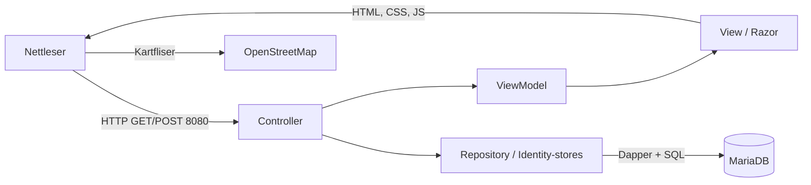

# KriseKlar

KriseKlar er en ASP.NET Core MVC-applikasjon som kjører i Docker. Hele appen krever innlogging. Brukere logger inn og ser beredskapsressurser og behov fra databasen. Innloggede brukere kan legge til ressurser og endre eller slette sine egne. Admin kan endre og slette alle ressurser og styre hvem som har hvilke roller.

**Gruppe:** 8 · **Emne:** IS-202 · **Medlemmer:** Darin, Marius, Lars, Mahan, Yasin

---

## Innhold

1. [Drift](#1-drift)
2. [Systemarkitektur](#2-systemarkitektur)
3. [Testing](#3-testing)
4. [Sikkerhet](#4-sikkerhet)
5. [Dokumentasjon i koden](#5-dokumentasjon-i-koden)
6. [Bruk av KI](#6-bruk-av-ki)

---

## 1. Drift

### Forutsetninger
- Docker 29.4.1 og Docker Compose
- Git
- (Ved lokal utvikling uten Docker) .NET SDK 10.0.401

### Kjøre applikasjonen

```bash
git clone https://github.com/MahanBig/Semster3
cd Semster3
cp .env.example .env         # Windows: copy .env.example .env  – bytt deretter passordet i .env
docker compose up --build
```

Applikasjonen er deretter tilgjengelig på `http://localhost:8080`. Logg inn som admin med `admin@heimevernet.local` og passordet fra `.env`.

I Visual Studio: sett **docker-compose** som startup-prosjekt og trykk **Docker Compose** på start-knappen. Det krever komponenten **Container development tools** (Visual Studio Installer → Modify → Individual components). Loggene til containerne finnes i Docker Desktop (klikk på containeren → Logs).

**Feilsøking med breakpoints:** Start containerne med `docker compose up -d`, sett **Heimevernet.Web** som startup-prosjekt og kjør profilen **http**. Da kjører web-appen direkte i Visual Studio på `http://localhost:5203` og bruker MariaDB-containeren via port 3307 (tilkoblingsstrengen står i `Properties/launchSettings.json`).

### Stoppe og rydde opp

```bash
docker compose down          # stopper containerne
docker compose down -v       # stopper og sletter volumer (database og innloggingsnøkler)
```

### Konfigurasjon

| Innstilling | Sted | Beskrivelse |
|---|---|---|
| `ASPNETCORE_ENVIRONMENT` | `docker-compose.yml` | `Development` / `Production` |
| `ConnectionStrings__heimevernetdb` | `docker-compose.yml` / `launchSettings.json` | Tilkobling til MariaDB: `Server=mariadb` inne i Docker, `localhost:3307` når web-appen kjører i Visual Studio |
| `DataProtection__KeysPath` | `docker-compose.yml` | Mappe for innloggingsnøklene (volumet `dataprotection-keys`), så brukere forblir innlogget etter omstart |
| `ADMIN_PASSWORD` | `.env` | Passord til første admin-bruker. Ligger aldri i Git |
| `ADMIN_EMAIL` | `.env` (valgfri) | E-post til første admin-bruker, standard `admin@heimevernet.local` |
| `MARIADB_ROOT_PASSWORD` | `.env` (valgfri) | Root-passord til MariaDB, standard `heimevernet-dev` (bare lokal utvikling) |

`.env.example` viser hvilke verdier som finnes. `.env` ligger i `.gitignore`.

### Innlogging, brukere og roller

Appen bruker ASP.NET Core Identity. Brukere og roller lagres i MariaDB (tabellene `AspNetUsers`, `AspNetRoles`, `AspNetUserRoles`) via egne Dapper-klasser: `DataAccess/Identity/DapperUserStore.cs` og `DapperRoleStore.cs`.

- Brukere og roller er klassene `ApplicationUser` og `ApplicationRole` (`Models/Entities/`). De arver fra Identity og har i tillegg feltene fra ER-diagrammet: navn, samtykke og opprettet på brukeren, og beskrivelse, tilgangsnivå og «krever godkjenning» på rollen.
- Rollene `Admin` og `Bruker` lages automatisk ved oppstart.
- Nye brukere registrerer seg på `/Account/Register` med navn, e-post, passord, telefon (valgfritt) og samtykke, og får rollen `Bruker`.
- `Admin` krever godkjenning: koblingen i `AspNetUserRoles` teller ikke før `VerifiedAt` har en verdi. Når en admin gir rollen på `/UserAdmin`, lagres hvem som godkjente og når. Den første admin-brukeren godkjennes av oppstarten.
- En admin-bruker lages ved oppstart med e-post og passord fra `.env`. Passordet må ha minst 8 tegn, stor og liten bokstav, et tall og et spesialtegn. Er det for svakt, starter appen uten admin-bruker og skriver en feilmelding i loggen.

| Side | Krever |
|---|---|
| Logg inn, Registrer deg, feilsiden | Ingenting |
| Alle andre sider: forside med kart, Ressurser, ressursdetaljer, Behov | Innlogging |
| Endre og slette ressurs (`/ResourceHandler/Edit/{id}`, `/ResourceHandler/Delete/{id}`) | Innlogging, og at du la inn ressursen selv, eller rollen `Admin` |
| Endre og slette behov (`/Need/Edit/{id}`, `/Need/Delete/{id}`) | Innlogging, og at du meldte inn behovet selv, eller rollen `Admin` |
| Tildele en ressurs til et behov (`/Need/Details/{id}`) | At du eier ressursen, eller rollen `Admin` |
| Brukere (`/UserAdmin`) | Rollen `Admin` |

Den som ikke er logget inn, sendes automatisk til innloggingssiden og kommer tilbake til siden de prøvde å åpne etter innlogging. Dette styres av en `FallbackPolicy` i `Program.cs`: alle sider krever innlogging hvis de ikke har `[AllowAnonymous]`. Da kan vi ikke glemme å beskytte en ny side.

Hvem som har lagt inn en ressurs eller et behov lagres i kolonnen `UserId` (fremmednøkkel til `AspNetUsers.Id`). Regelen for hvem som får endre og slette står på ett sted, i `Authorization/ResourcePermissions.cs`, og brukes både av controlleren (som stopper forespørselen) og av viewet (som skjuler knappene). Ressursene fra eksempeldataene har ingen eier, så bare admin kan endre dem.

### Database og tabeller

Tabellene lages av `Heimevernet.Web/DataAccess/Sql/Schema.sql`, som kjøres hver gang appen starter (`CREATE TABLE IF NOT EXISTS`). Skal en tabell endres senere, må det skrives en `ALTER TABLE` i tillegg. Tabellene følger ER-diagrammet, men med Identity sine tabeller for bruker og rolle og engelske tabellnavn.

Har du en database fra før kategori, lokasjon og behov kom inn, stopper appen ved oppstart med en melding om det. Slett den gamle databasen med `docker compose down -v` og start på nytt.

| Tabell (ER-diagrammet) | Innhold |
|---|---|
| `AspNetUsers` (Bruker) | Brukere: e-post, passord-hash, telefon, navn, samtykke, opprettet |
| `AspNetRoles` (Rolle) | Roller: navn, beskrivelse, tilgangsnivå, om rollen krever godkjenning |
| `AspNetUserRoles` (BrukerRolle) | Hvem som har hvilken rolle, og hvem som godkjente den og når |
| `Resources` (Ressurs) | Ressurser: navn, beskrivelse, antall, status, kategori, lokasjon, eier |
| `Needs` (Behov) | Behov: tittel, beskrivelse, antall, prioritet, status, frist, kategori, lokasjon, organisasjon, hvem som meldte det inn |
| `Allocations` (Tildeling) | Hvilke ressurser som er gitt til hvilke behov, og hvor mange |
| `Categories` (Kategori) | De sju kategoriene (Mat, Vann, ...). Legges inn av `Schema.sql` |
| `Locations` (Lokasjon) og `PostalCodes` (Poststed) | Adressen til en ressurs eller et behov, og postnummer med poststed |
| `Organizations`, `Competences`, `UserOrganizations`, `UserCompetences`, `ResourceCompetences` | Organisasjoner og kompetanser. Tabellene finnes, men har ingen sider i appen ennå |

Statusene oppdateres automatisk når ressurser tildeles (`DataAccess/DapperAllocationRepository.cs`): et behov er `åpen` uten tildelinger, `under_behandling` når noe er tildelt, og `dekket` når summen av tildelt antall når antallet som trengs. En ressurs er `i_bruk` så lenge den er tildelt et behov.

---

## 2. Systemarkitektur

### Oversikt



### Lag og ansvar

| Lag | Ansvar | Filer/mapper |
|---|---|---|
| Controller | Tar imot GET/POST, validerer, sjekker innlogging/roller, velger view | `Controllers/` |
| ViewModel | Data og valideringsregler mellom controller og view | `Models/ViewModels/` |
| Entity | Én rad i en databasetabell | `Models/Entities/` |
| Data access | SQL med Dapper, repositories og Identity-stores, tabelloppsett | `DataAccess/` |
| View | Razor-sider, responsivt design med Bootstrap | `Views/` |
| Statiske filer | CSS, JavaScript, Bootstrap, jQuery, Leaflet | `wwwroot/` |

Controllerne kjenner bare grensesnittene (`IResourceRepository`, `INeedRepository` osv.). De ekte Dapper-klassene registreres i `Program.cs` med dependency injection, og testene bruker falske versjoner.

### Dataflyt

**Ressurser:** `/ResourceHandler` lister ressursene fra databasen, `/Resource/Index/{id}` viser én ressurs. Innloggede brukere legger til nye på `/ResourceHandler/Create`, og eier eller admin endrer (`Edit`) og sletter (`Delete`, med en bekreftelsesside først). Etter hver lagring sendes brukeren videre med Post/Redirect/Get og en kort bekreftelse.

**Kart, avstand og filtre:**
- Hver ressurs kan ha et punkt på kartet. Det lagres i `Locations.Latitude` og `Locations.Longitude` sammen med adressen (`DataAccess/LocationWriter.cs`).
- Punktet velges i et lite kart i skjemaet (klikk, dra markøren eller «Bruk min posisjon»). På forsiden slår +-knappen på «Legg til»-modus. Bare da setter et klikk i kartet en pinne, så ingen legger til en ressurs på feil sted ved et uhell. «Registrer ressurs her» går til «Ny ressurs» med punktet ferdig valgt (`/ResourceHandler/Create?lat=…&lng=…`). «Avbryt» eller Escape avslutter modusen.
- Forsiden viser ressursene som markører i kategorifargen og listen «Nærmest deg», sortert etter avstand. Kartene starter i Kristiansand, flyttes dit brukeren er hvis posisjonen deles, og holder seg innenfor Norge.
- `/ResourceHandler` følger designet «Ressurser nær deg»: rutenett eller kart, søk, og filtre for avstand (1–25 km), kategori (med antall), sted, «Tilgjengelige nå» og sortering.
- Avstanden regnes ut i nettleseren (`wwwroot/js/site.js`) fra posisjonen nettleseren gir. Posisjonen sendes aldri til serveren og lagres bare i fanen (`sessionStorage`). Sier brukeren nei, virker alt unntatt avstand.
- Appen bruker fast kultur (`UseRequestLocalization` i `Program.cs`), så koordinater alltid skrives og leses med punktum, også på en norsk Windows-maskin.

### Teknologivalg

| Teknologi | Begrunnelse |
|---|---|
| ASP.NET Core MVC (.NET 10) | Krav i oppgaven |
| Docker og Docker Compose | Likt kjøremiljø på alle maskiner, én kommando starter alt |
| Leaflet 1.9.4 + OpenStreetMap | Fra forelesning. Gratis kart uten API-nøkkel |
| Bootstrap 5 + eget designsystem (`wwwroot/css/site.css`) | Responsivt design. Farger, komponenter og sideoppsett følger designet «Beredskapskart». Navnet og logoen er KriseKlar (`wwwroot/img/kriseklar.svg`) |
| Atkinson Hyperlegible (Google Fonts) | Skrift laget for god lesbarhet, valgt i designet |
| MariaDB | Fra forelesning |
| Dapper + MySqlConnector | Vi skriver SQL-en selv og ser nøyaktig hva som sendes til databasen. Dapper gjør radene om til C#-objekter |
| ASP.NET Core Identity | Ferdig og sikker håndtering av passord-hashing, innlogging, låsing av konto og roller |

### Docker

- `Heimevernet.Web/Dockerfile`: multi-stage build. Steg 1 bruker .NET SDK-imaget til å hente pakker og publisere appen. Steg 2 kopierer bare resultatet inn i det mindre ASP.NET runtime-imaget og starter appen på port 8080 som en vanlig bruker (ikke root).
- `docker-compose.yml`: to tjenester.
  - `mariadb` (imaget `mariadb:lts`): databasen. Dataene lagres i volumet `mariadb-data`, så de overlever omstart. En healthcheck sier fra når databasen er klar. Port 3307 er åpen mot Windows for kjøring fra Visual Studio.
  - `heimevernet-web`: bygges fra Dockerfile, publiseres på `http://localhost:8080`, får tilkoblingsstrengen og admin-innstillingene som miljøvariabler, og starter først når `mariadb` er klar (`depends_on: service_healthy`). Innloggingsnøklene lagres i volumet `dataprotection-keys`.
- Inne i Docker-nettverket når web-containeren databasen med vertsnavnet `mariadb`, altså navnet på tjenesten.

---

## 3. Testing

### Automatiske tester

`Heimevernet.Web.UnitTests` har tester for controllerne, Dapper-repositoriene, seederne, Identity-stores og tilgangsregelen for ressurser (`ResourcePermissionsTests`, `ResourceEditDeleteTests`). Databasetestene kjører den samme SQL-en mot en midlertidig SQLite-database i minnet (`SqliteTestDatabase.cs`), så det trengs ingen MariaDB-server. GitHub Actions kjører testene og bygger Docker-imaget ved hver push og pull request til `main`.

```bash
dotnet test --project .\Heimevernet.Web.UnitTests\Heimevernet.Web.UnitTests.csproj
```

### System- og sikkerhetstest

`tests/system/system-og-sikkerhetstest.ps1` tester hele løsningen slik den kjører i Docker: nettleser → web-container → MariaDB. Skriptet later som det er fire nettlesere samtidig (utlogget, admin og to vanlige brukere, Ola og Kari) og sjekker både at funksjonene virker og at sikkerhetstiltakene i [kapittel 4](#4-sikkerhet) faktisk stopper angrep. Resultatet skrives til skjermen og til `tests/system/resultat.md`.

```powershell
docker compose up --build -d
pwsh -File tests/system/system-og-sikkerhetstest.ps1
```

Testscenarioer:

| Område | Hva testes |
|---|---|
| Systemtest | Sidene åpnes, ressurser fra databasen vises, registrering og innlogging, legge til / endre / slette ressurs (krav 3), punkt på kartet lagres og vises, «Legg til ressurs her» fyller inn punktet, filtrene finnes på ressurssiden, validering av skjema, data overlever omstart av containeren |
| Tilgangskontroll | Utlogget sendes til innlogging fra alle sider (også forsiden og ressurslisten), mens innloggingssiden, CSS og logo er åpne, vanlig bruker får «Ingen tilgang» på admin-sider, Kari får ikke endre eller slette Olas ressurs, verken via knappene eller ved å sende POST direkte |
| CSRF | POST uten anti-forgery-token gir 400 Bad Request |
| XSS | `<script>` i en beskrivelse vises som tekst og kjøres ikke |
| SQL-injeksjon | `'); DROP TABLE Resources; --` lagres som vanlig tekst, tabellen finnes fortsatt |
| Åpen redirect | `ReturnUrl=https://evil.example.com` ved innlogging blir ignorert |
| Passord og konto | Svakt passord avvises, samme e-post kan ikke brukes to ganger, samme feilmelding for ukjent e-post og feil passord, kontoen låses etter 5 feil passord |
| Headere og cookie | Sikkerhets-headerne er med på alle svar, og innloggings-cookien er `HttpOnly` |

**Resultat:** se [Testresultater](#testresultater) under.

### Brukervennlighetstest

Malen ligger i [`docs/brukervennlighetstest.md`](docs/brukervennlighetstest.md): sju oppgaver testpersonene skal løse (finne ressurs, registrere seg, legge til / endre / slette ressurs), en tabell for resultater og tid, SUS-spørreskjemaet og en tabell for funn og tiltak.

> **TODO (gruppen):** Gjennomfør testen med 3–5 personer, fyll inn malen og skriv en kort oppsummering her: gjennomsnittlig SUS-poeng, hva som var vanskelig og hva dere endret.

### Manuelle tester

| # | Test | Forventet resultat | Resultat |
| --- | --- | --- | --- |
| 1 | Kjør `docker compose up --build` og sjekk Docker Desktop | Containerne heimevernet-web og mariadb kjører | Bestått |
| 2 | Logg inn og åpne Ressurser | En liste med ressurser fra databasen vises | Bestått |
| 3 | Klikk på en ressurs | Detaljsiden for ressursen vises | Bestått |
| 4 | Åpne en hvilken som helst side uten å være logget inn | Sendes til innloggingssiden. Etter innlogging kommer man tilbake til siden | Bestått |
| 5 | Registrer en ny bruker | Logges inn automatisk med rollen Bruker | Bestått |
| 6 | Logg inn som Bruker og åpne /UserAdmin | Siden «Ingen tilgang» vises | Bestått |
| 7 | Logg inn som admin, åpne Brukere og gi en bruker Admin-rollen | Rollen vises i tabellen og lagres i AspNetUserRoles | Bestått |
| 8 | Som innlogget bruker: Ressurser → Ny ressurs, fyll ut og lagre | Detaljsiden viser den nye ressursen med «Ressursen ble lagret» og «Lagt inn av …» | Bestått |
| 9 | Start web-containeren på nytt (`docker compose restart heimevernet-web`) | Ressurser og brukere er der fortsatt, og man er fortsatt logget inn | Bestått |
| 10 | Åpne din egen ressurs, trykk Endre, bytt beskrivelse og lagre | Detaljsiden viser den nye beskrivelsen og «Endringene ble lagret» | Bestått |
| 11 | Trykk Slett på din egen ressurs, bekreft | Sendes til listen med «Ressursen … ble slettet», ressursen er borte | Bestått |
| 12 | Logg inn som en annen bruker og åpne ressursen fra test 10 | Knappene Endre og Slett vises ikke. `/ResourceHandler/Edit/{id}` gir «Ingen tilgang» | Bestått |
| 13 | Bruk appen på mobil (eller smal nettleser) | Menyen, kartet og skjemaene tilpasser seg skjermen | Bestått |

### Testresultater

Kjørt 5. november 2026 mot appen i Docker (`docker compose up --build -d`).

| Test | Antall | Bestått |
|---|---|---|
| Enhetstester (`dotnet test`) | 79 | 79 ✅ |
| Systemtest (`tests/system/system-og-sikkerhetstest.ps1`) | 31 | 31 ✅ |
| Sikkerhetstest (samme skript) | 30 | 30 ✅ |
| Manuelle tester (tabellen over) | 13 | 13 ✅ |
| Brukervennlighetstest | *TODO* | *TODO* |

Hele listen med hver enkelt sjekk står i [`tests/system/resultat.md`](tests/system/resultat.md).

**Funn underveis:** Første kjøring (3. november) ga 54 av 55. Sjekken for låsing av konto feilet, men databasen viste at kontoen faktisk ble låst (`LockoutEnd` var satt). Feilen var i testen: Razor HTML-koder «å» i feilmeldingen som `&#xE5;`, så teksten «låst» ble ikke funnet. Testen ble rettet til å se etter «Kontoen er midlertidig».

---

## 4. Sikkerhet

Tiltakene under er testet automatisk i `tests/system/system-og-sikkerhetstest.ps1` og i enhetstestene (se [kapittel 3](#3-testing)).

| Trussel | Tiltak | Hvor i koden |
|---|---|---|
| Passord på avveie | Passord lagres aldri i klartekst. Identity lagrer en saltet hash (PBKDF2). Krav: minst 8 tegn, stor og liten bokstav, tall og spesialtegn | `Program.cs` (`AddIdentity`), `DataAccess/Identity/DapperUserStore.cs` |
| Gjetting av passord (brute force) | Kontoen låses i 5 minutter etter 5 feil passord | `Program.cs` (`Lockout`), `Controllers/AccountController.cs` (`lockoutOnFailure: true`) |
| Finne ut hvilke e-poster som finnes | Samme feilmelding for ukjent e-post og feil passord | `Controllers/AccountController.cs` |
| Uautorisert tilgang | Alle sider krever innlogging (`FallbackPolicy`), bortsett fra de som er merket `[AllowAnonymous]` (logg inn, registrer, feilside). `[Authorize]` på sider som krever innlogging og `[Authorize(Roles = Admin)]` på admin-sider. For endring og sletting sjekker controlleren i tillegg at brukeren eier ressursen eller er admin, både på GET og POST, så det hjelper ikke å skrive adressen selv eller sende en POST direkte | `Program.cs`, `Controllers/ResourceHandlerController.cs`, `Authorization/ResourcePermissions.cs`, `Controllers/UserAdminController.cs` |
| Overposting (sende med felt man ikke skal kunne endre) | Eier, status på behov og `CanModify` har `[BindNever]`, så de kan ikke sendes inn fra et skjema. Eieren (`UserId`) settes alltid fra innlogget bruker på serveren, og `UPDATE`-setningene endrer aldri `UserId`. Kategori og organisasjon fra skjemaet slås opp i databasen før lagring | `Models/ViewModels/Resource/ResourceViewModel.cs`, `DataAccess/DapperResourceRepository.cs` |
| SQL-injeksjon | All SQL bruker parametere (`@Name`) via Dapper. Brukerens tekst settes aldri rett inn i SQL-strengen | `DataAccess/` |
| Cross-site scripting (XSS) | Razor HTML-koder alt som skrives ut (`@Model.Name`) | `Views/` |
| Cross-site request forgery (CSRF) | Alle skjema har en anti-forgery-token, og alle POST-actions har `[ValidateAntiForgeryToken]` | `Controllers/` |
| Åpen redirect | `ReturnUrl` etter innlogging brukes bare hvis den peker til vår egen side (`Url.IsLocalUrl`) | `Controllers/AccountController.cs` |
| Stjålet innloggings-cookie | Cookien er `HttpOnly` (JavaScript kan ikke lese den) og krypteres med Data Protection. Nøklene lagres i et eget volum | `Program.cs`, `docker-compose.yml` |
| Clickjacking og andre nettleserangrep | Sikkerhets-headere på alle svar: `X-Frame-Options: DENY`, `X-Content-Type-Options: nosniff`, `Referrer-Policy`, `Permissions-Policy` | `Program.cs` |
| Ugyldige data | Validering med attributter (`[Required]`, `[StringLength]`, `[RegularExpression]` for postnummer, `[Phone]`) både i nettleseren og på serveren (`ModelState.IsValid`) | `Models/ViewModels/` |
| Hemmeligheter i Git | Admin-passordet og root-passordet til databasen ligger i `.env`, som er i `.gitignore` | `.env.example`, `.gitignore` |
| Container blir tatt over | Web-containeren kjører som en vanlig bruker, ikke root (`USER $APP_UID`). Runtime-imaget har ikke SDK-en | `Heimevernet.Web/Dockerfile` |
| Feilmeldinger som avslører kode | I produksjon vises en generell feilside (`UseExceptionHandler`), ikke stack trace | `Program.cs` |

### Kjente begrensninger

- Lokalt i Docker kjører appen på HTTP. I produksjon (`ASPNETCORE_ENVIRONMENT=Production`) slås HTTPS-omdirigering og HSTS på, men da trengs et sertifikat eller en proxy foran (f.eks. nginx).
- Vi har ikke Content-Security-Policy, fordi noen views har små `<script>`-blokker og vi bruker Google Fonts og OpenStreetMap. Neste steg er å flytte scriptene til `site.js` og legge til en CSP.
- MariaDB-porten 3307 er åpen mot maskinen for utvikling i Visual Studio. Den bør fjernes i produksjon.
- Det er ingen e-postbekreftelse ved registrering, så hvem som helst kan lage en bruker og legge inn ressurser.

---

## 5. Dokumentasjon i koden

- Koden er kommentert på norsk der det skjer noe som ikke er åpenbart: hvorfor vi bruker parametere i SQL (SQL injection), anti-forgery-tokens (CSRF), optimistisk låsing med `ConcurrencyStamp` og hvorfor innloggingsnøklene lagres i et volum.
- `Schema.sql` beskriver hver tabell og de viktigste kolonnene.
- `Program.cs` forklarer rekkefølgen på oppstart (tabeller → eksempeldata → roller og admin) og på middleware (`UseAuthentication` før `UseAuthorization`).
- `docker-compose.yml` og `Dockerfile` forklarer hvert steg.

---

## 6. Bruk av KI

### Verktøy

| Verktøy | Hvem brukte det | Hva vi brukte det til |
|---|---|---|
| Claude (claude.ai, med tilgang til prosjektmappen) | Mahan | Forklaring av prosjektet, Identity og roller, overgang fra EF til Dapper, Docker Compose, feilsøking, frontend fra designet, krav 3, sikkerhetstester |
| Claude Design | Mahan | Designet «Beredskapskart» (farger, skrift, sideoppsett) |
| *TODO: andre verktøy (ChatGPT, Copilot …)* | *TODO* | *TODO* |

### Bruk i hver fase

| Fase | Hva KI gjorde | Hva vi gjorde selv |
|---|---|---|
| Idé og planlegging | Gikk gjennom kravene i oppgaven og laget en liste over hva som manglet (krav 3, 8, 9 og 12) | Valgte hva vi skulle prioritere |
| Design | Claude Design laget designet «Beredskapskart». Claude gjorde det om til Razor-sider og CSS | Valgte design og sjekket det på PC og mobil |
| Koding | Skrev overgangen fra Entity Framework til Dapper (repositoriene, Identity-stores og `Schema.sql`), Docker Compose-oppsettet, lagring av kartposisjoner, og legge til / endre / slette ressurser med eierskap | Kjørte koden, gikk gjennom den og forklarte den med egne ord før den ble lagt inn |
| Testing | Skrev enhetstester og system- og sikkerhetstesten, og malen for brukervennlighetstesten | Kjørte testene og gjennomførte brukervennlighetstesten |
| Feilsøking | Fant årsaken til feil, f.eks. at containeren krasjet med kode 139 (for svakt admin-passord), at Visual Studio og terminalen brukte hver sin database (ulikt prosjektnavn i Compose) og at kartet ble smalt (Leaflet måtte få beskjed om ny størrelse) | Beskrev problemet og testet løsningen |
| Dokumentasjon | Hjalp med struktur og innhold i README | Skrev om og fylte inn det som gjelder gruppen |

### Eksempler på prompts

| Prompt (forkortet) | Formål | Resultat |
|---|---|---|
| «Kan du hjelpe meg med å forklare meg alt i denne mappen og teknologier og hvordan ting er satt sammen» | Forstå prosjektet | Gjennomgang av lagene (controller, viewmodel, repository, database) og Docker |
| «Kan du med identity framework legge til login, brukere og roller og lagre dette i mariadb» | Innlogging og roller | Identity med rollene Admin og Bruker, lagret i MariaDB |
| «Kan vi bytte til dapper istedenfor EF» | Skrive SQL-en selv | Repositorier og Identity-stores med Dapper og `Schema.sql` |
| «Container exited unexpectedly with exit code 139» | Feilsøking | Fant at admin-passordet manglet spesialtegn. Appen logger nå en feilmelding i stedet for å krasje |
| «Is it possible to fully switch to a docker compose instead of aspire?» | Enklere drift | Aspire byttet ut med `docker-compose.yml` |
| «Kan du sjekke gjennom disse kravene» (lenke til oppgaven) | Se hva som manglet | Liste over krav som var oppfylt, delvis oppfylt og manglet |
| *TODO: legg til prompts fra de andre i gruppen* | | |

### Refleksjon
- Hva fungerte godt med KI: Når vi satt fast med problemer var det et bra verktøy for å forstå problemet og å hjelpe oss med problemet
- Hva fungerte dårlig eller måtte rettes: Når et problem oppsto så var vi litt kjappe til å bare få hjelp av Claude. Testene som KI skrev fant også feil i testene selv (f.eks. at Razor gjør «å» om til `&#xE5;`), så resultatet måtte alltid sjekkes
- Hvordan vi kontrollerte at KI-generert kode var riktig: Vi kjørte enhetstestene og system- og sikkerhetstesten, testet manuelt i nettleseren og gikk gjennom koden
- Hva vi ville gjort annerledes: Vi ble generelt ganske fornøyd med vår prossess med oppgaven
- *TODO (gruppen): Hva lærte vi selv, og hva ville vi ikke klart uten KI?*
