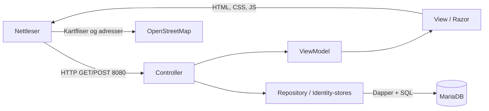

# Heimevernet

ASP.NET Core MVC-applikasjon som kjører i Docker. Brukere logger inn, registrerer posisjoner i et kart og ser ressurser fra databasen. Admin kan legge til ressurser og styre hvem som har hvilke roller.

**Gruppe:** 8 · **Emne:** IS-202 · **Medlemmer:** Darin, Marius, Lars, Mahan, Yasin

---

## Innhold

1. [Drift](#1-drift)
2. [Systemarkitektur](#2-systemarkitektur)
3. [Testing](#3-testing)
4. [Dokumentasjon i koden](#4-dokumentasjon-i-koden)
5. [Bruk av KI](#5-bruk-av-ki)

---

## 1. Drift

### Forutsetninger
- Docker 29.4.1 og Docker Compose
- Git
- (Ved lokal utvikling uten Docker) .NET SDK 10.0.401

### Kjøre applikasjonen

```bash
git clone https://github.com/MahanBig/Semster3
cd Semster3
cp .env.example .env         # Windows: copy .env.example .env  – bytt deretter passordet i .env
docker compose up --build
```

Applikasjonen er deretter tilgjengelig på `http://localhost:8080`. Logg inn som admin med `admin@heimevernet.local` og passordet fra `.env`.

I Visual Studio: sett **docker-compose** som startup-prosjekt og trykk **Docker Compose** på start-knappen. Det krever komponenten **Container development tools** (Visual Studio Installer → Modify → Individual components). Loggene til containerne finnes i Docker Desktop (klikk på containeren → Logs).

**Feilsøking med breakpoints:** Start containerne med `docker compose up -d`, sett **Heimevernet.Web** som startup-prosjekt og kjør profilen **http**. Da kjører web-appen direkte i Visual Studio på `http://localhost:5203` og bruker MariaDB-containeren via port 3307 (tilkoblingsstrengen står i `Properties/launchSettings.json`).

### Stoppe og rydde opp

```bash
docker compose down          # stopper containerne
docker compose down -v       # stopper og sletter volumer (database og innloggingsnøkler)
```

### Konfigurasjon

| Innstilling | Sted | Beskrivelse |
|---|---|---|
| `ASPNETCORE_ENVIRONMENT` | `docker-compose.yml` | `Development` / `Production` |
| `ConnectionStrings__heimevernetdb` | `docker-compose.yml` / `launchSettings.json` | Tilkobling til MariaDB: `Server=mariadb` inne i Docker, `localhost:3307` når web-appen kjører i Visual Studio |
| `DataProtection__KeysPath` | `docker-compose.yml` | Mappe for innloggingsnøklene (volumet `dataprotection-keys`), så brukere forblir innlogget etter omstart |
| `ADMIN_PASSWORD` | `.env` | Passord til første admin-bruker. Ligger aldri i Git |
| `ADMIN_EMAIL` | `.env` (valgfri) | E-post til første admin-bruker, standard `admin@heimevernet.local` |
| `MARIADB_ROOT_PASSWORD` | `.env` (valgfri) | Root-passord til MariaDB, standard `heimevernet-dev` (bare lokal utvikling) |

`.env.example` viser hvilke verdier som finnes. `.env` ligger i `.gitignore`.

### Innlogging, brukere og roller

Appen bruker ASP.NET Core Identity. Brukere og roller lagres i MariaDB (tabellene `AspNetUsers`, `AspNetRoles`, `AspNetUserRoles`) via egne Dapper-klasser: `DataAccess/Identity/DapperUserStore.cs` og `DapperRoleStore.cs`.

- Rollene `Admin` og `Bruker` lages automatisk ved oppstart.
- Nye brukere registrerer seg på `/Account/Register` og får rollen `Bruker`.
- En admin-bruker lages ved oppstart med e-post og passord fra `.env`. Passordet må ha minst 8 tegn, stor og liten bokstav, et tall og et spesialtegn. Er det for svakt, starter appen uten admin-bruker og skriver en feilmelding i loggen.

| Side | Krever |
|---|---|
| Forside, Ressurser, ressursdetaljer, Registrerte posisjoner | Ingenting |
| Korriger kart (registrere posisjon) | Innlogging |
| Ny ressurs (`/ResourceHandler/Create`) | Rollen `Admin` |
| Brukere (`/UserAdmin`) | Rollen `Admin` |

### Database og tabeller

Tabellene lages av `Heimevernet.Web/DataAccess/Sql/Schema.sql`, som kjøres hver gang appen starter (`CREATE TABLE IF NOT EXISTS`). Skal en tabell endres senere, må det skrives en `ALTER TABLE` i tillegg.

| Tabell | Innhold |
|---|---|
| `Resources` | Ressurser (navn, beskrivelse, type, adresse, eiers telefon) |
| `Positions` | Posisjoner fra kartet (koordinater, beskrivelse, hvem og når) |
| `AspNetUsers`, `AspNetRoles`, `AspNetUserRoles` | Brukere, roller og koblingen mellom dem |

---

## 2. Systemarkitektur

### Oversikt



### Lag og ansvar

| Lag | Ansvar | Filer/mapper |
|---|---|---|
| Controller | Tar imot GET/POST, validerer, sjekker innlogging/roller, velger view | `Controllers/` |
| ViewModel | Data og valideringsregler mellom controller og view | `Models/ViewModels/` |
| Entity | Én rad i en databasetabell | `Models/Entities/` |
| Data access | SQL med Dapper, repositories og Identity-stores, tabelloppsett | `DataAccess/` |
| View | Razor-sider, responsivt design med Bootstrap | `Views/` |
| Statiske filer | CSS, JavaScript, Bootstrap, jQuery, Leaflet | `wwwroot/` |

Controllerne kjenner bare grensesnittene (`IResourceRepository`, `IPositionRepository`). De ekte Dapper-klassene registreres i `Program.cs` med dependency injection, og testene bruker falske versjoner.

### Dataflyt

1. **Skjema:** `GET /Home/CorrectMap` viser skjemaet og kartet (krever innlogging). Ved innsending sender nettleseren `POST /Home/CorrectMap` med en anti-forgery-token.
2. **Kart:** Brukeren klikker i Leaflet-kartet. JavaScript skriver koordinatene i to skrivebeskyttede felt i skjemaet, og de sendes med POST. Controlleren sjekker at de er gyldige tall innenfor -90/90 og -180/180.
3. **Lagring og visning:** Posisjonen lagres i tabellen `Positions`. Deretter redirecter appen (Post/Redirect/Get) til `/Home/CorrectionOverview`, som viser alle posisjoner i en tabell og som markører på kartet.
4. **Ressurser:** `/ResourceHandler` lister ressursene fra databasen, `/Resource/Index/{id}` viser én ressurs, og admin legger til nye på `/ResourceHandler/Create`.

### Teknologivalg

| Teknologi | Begrunnelse |
|---|---|
| ASP.NET Core MVC (.NET 10) | Krav i oppgaven |
| Docker og Docker Compose | Likt kjøremiljø på alle maskiner, én kommando starter alt |
| Leaflet 1.9.4 + OpenStreetMap | Fra forelesning. Gratis kart uten API-nøkkel |
| Bootstrap 5 + eget designsystem (`wwwroot/css/site.css`) | Responsivt design. Farger, komponenter og sideoppsett følger designet «Beredskapskart» |
| Atkinson Hyperlegible (Google Fonts) | Skrift laget for god lesbarhet, valgt i designet |
| MariaDB | Fra forelesning |
| Dapper + MySqlConnector | Vi skriver SQL-en selv og ser nøyaktig hva som sendes til databasen. Dapper gjør radene om til C#-objekter |
| ASP.NET Core Identity | Ferdig og sikker håndtering av passord-hashing, innlogging, låsing av konto og roller |

### Docker

- `Heimevernet.Web/Dockerfile`: multi-stage build. Steg 1 bruker .NET SDK-imaget til å hente pakker og publisere appen. Steg 2 kopierer bare resultatet inn i det mindre ASP.NET runtime-imaget og starter appen på port 8080 som en vanlig bruker (ikke root).
- `docker-compose.yml`: to tjenester.
  - `mariadb` (imaget `mariadb:lts`): databasen. Dataene lagres i volumet `mariadb-data`, så de overlever omstart. En healthcheck sier fra når databasen er klar. Port 3307 er åpen mot Windows for kjøring fra Visual Studio.
  - `heimevernet-web`: bygges fra Dockerfile, publiseres på `http://localhost:8080`, får tilkoblingsstrengen og admin-innstillingene som miljøvariabler, og starter først når `mariadb` er klar (`depends_on: service_healthy`). Innloggingsnøklene lagres i volumet `dataprotection-keys`.
- Inne i Docker-nettverket når web-containeren databasen med vertsnavnet `mariadb`, altså navnet på tjenesten.

---

## 3. Testing

### Automatiske tester

`Heimevernet.Web.UnitTests` har tester for controllerne, Dapper-repositoriene, seederne og Identity-stores. Databasetestene kjører den samme SQL-en mot en midlertidig SQLite-database i minnet (`SqliteTestDatabase.cs`), så det trengs ingen MariaDB-server. GitHub Actions kjører testene og bygger Docker-imaget ved hver push og pull request til `main`.

```bash
dotnet test --project .\Heimevernet.Web.UnitTests\Heimevernet.Web.UnitTests.csproj
```

### Manuelle tester

| # | Test | Forventet resultat | Resultat |
| --- | --- | --- | --- |
| 1 | Kjør `docker compose up --build` og sjekk Docker Desktop | Containerne heimevernet-web og mariadb kjører | Bestått |
| 2 | Åpne Ressurser | En liste med ressurser fra databasen vises | Bestått |
| 3 | Klikk på en ressurs | Detaljsiden for ressursen vises | Bestått |
| 4 | Åpne Korriger kart uten å være logget inn | Sendes til innloggingssiden | Bestått |
| 5 | Registrer en ny bruker | Logges inn automatisk med rollen Bruker | Bestått |
| 6 | Korriger kart: klikk i kartet, skriv beskrivelse og lagre | Oversikten viser posisjonen i tabellen og på kartet | Bestått |
| 7 | Lagre uten å klikke i kartet | Feilmelding, ingenting lagres | Bestått |
| 8 | Logg inn som Bruker og åpne /UserAdmin | Siden «Ingen tilgang» vises | Bestått |
| 9 | Logg inn som admin, åpne Brukere og gi en bruker Admin-rollen | Rollen vises i tabellen og lagres i AspNetUserRoles | Bestått |
| 10 | Som admin: Ressurser → Ny ressurs, fyll ut og lagre | Detaljsiden viser den nye ressursen med «Ressursen ble lagret» | Bestått |
| 11 | Start web-containeren på nytt (`docker compose restart heimevernet-web`) | Ressurser, posisjoner og brukere er der fortsatt, og man er fortsatt logget inn | Bestått |

---

## 4. Dokumentasjon i koden

- Koden er kommentert på norsk der det skjer noe som ikke er åpenbart: hvorfor vi bruker parametere i SQL (SQL injection), anti-forgery-tokens (CSRF), Post/Redirect/Get, optimistisk låsing med `ConcurrencyStamp` og hvorfor innloggingsnøklene lagres i et volum.
- `Schema.sql` beskriver hver tabell og de viktigste kolonnene.
- `Program.cs` forklarer rekkefølgen på oppstart (tabeller → eksempeldata → roller og admin) og på middleware (`UseAuthentication` før `UseAuthorization`).
- `docker-compose.yml` og `Dockerfile` forklarer hvert steg.

---

## 5. Bruk av KI


### Oversikt

- Vi brukte Claude til å strukturere oppgaven og hjelpe oss videre når det oppsto problemer
- Vi brukte Claude til å hjelpe oss med å få opp README mappen og strukturere den siden vi var ikke sikre på hvordan den skulle se ut
- Vi fikk Claude til å se gjennom koden for å feilsøke og hjelpe med eventuelle endringer
- Frontenden er laget etter et design fra Claude Design («Beredskapskart»). Claude gjorde designet om til Razor-sider og CSS
- Claude skrev overgangen fra Entity Framework til Dapper (repositoriene, Identity-stores og `Schema.sql`), Docker Compose-oppsettet, lagring av kartposisjoner og siden for nye ressurser. Vi kjørte testene og gikk gjennom koden etterpå

## Eksempel på prompt
Verktøy: Claude
Formål: Finne ut hvor mye av oppgaven som var ferdig.
Resultat: Claude gikk gjennom det vi hadde og den viste at README var litt tynn og måtte jobbes videre med, så vi fikk en god struktur på hvordan vi kunne gjøre det


### Refleksjon
- Hva fungerte godt med KI: Når vi satt fast med problemer var det et bra verktøy for å forstå problemet og å hjelpe oss med problemet
- Hva fungerte dårlig eller måtte rettes: Når et problem oppsto så var vi litt kjappe til å bare få hjelp av Claude
- Hvordan vi kontrollerte at KI-generert kode var riktig: Vi testet koden og gikk gjennom den
- Hva vi ville gjort annerledes: Vi ble generelt ganske fornøyd med vår prossess med oppgaven
