# Bruksanvisning for KriseKlar

KriseKlar er en nettside der man kan finne og melde inn ressurser (vann, mat, strøm, førstehjelp osv.) og behov i en krisesituasjon. Appen ligger på <https://app.mahan.world>.

Bruksanvisningen er delt i to:

1. **Administrator** – alt en admin kan gjøre (vises først).
2. **Vanlig bruker** – hva som er annerledes når man er logget inn uten admin-rolle.

> Bildene ligger i [`bilder/`](bilder/).

---

## Del 1: Administrator

### Menyen

Menyen til venstre finnes på alle sider:

| Menyvalg | Hva den gjør |
|---|---|
| **Kart** | Forsiden med kart over alle ressurser. |
| **Ressurser** | Liste over ressurser, med filtre og søk. |
| **Behov** | Liste over behov som er meldt inn. |
| **Admin** | Administrasjon av brukere, roller, ressurser og behov (bare for admin). |
| **Innstillinger** | Din profil, passord og dine data. |

Nederst i menyen ser du nødnumrene (**110** brann, **112** politi, **113** ambulanse), hvem du er logget inn som, knappen **Logg ut** og lenken **Personvern**.

### 1. Kartet (forsiden)

Kartet viser alle ressursene som fargede ikoner. Den blå prikken er der du er. Til høyre ser du listen **Nærmest deg**, sortert etter avstand. Trykk **Oppdater posisjon** hvis avstandene er feil.

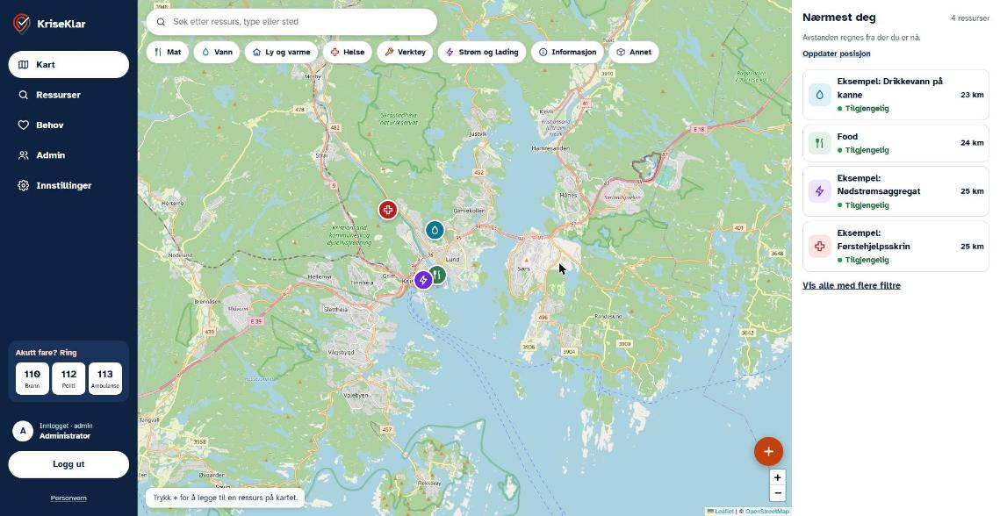

**Se en ressurs:** Klikk på et ikon i kartet. Da kommer en boks med navn, kategori og avstand. Trykk **Se ressursen** for å åpne den.

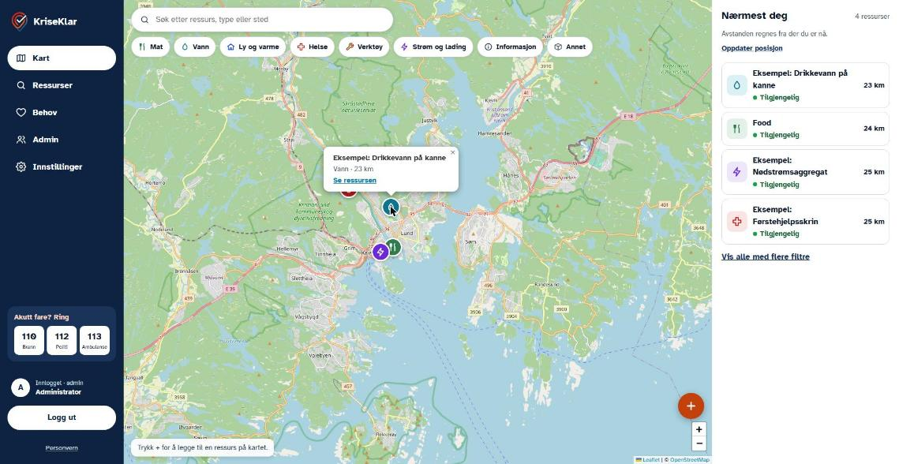

**Filtrer på kategori:** Trykk på en av knappene øverst (Mat, Vann, Ly og varme, Helse, Verktøy, Strøm og lading, Informasjon, Annet). Da vises bare den kategorien, både i kartet og i listen. Trykk på knappen igjen for å fjerne filteret. Du kan også søke i feltet **Søk etter ressurs, type eller sted**.

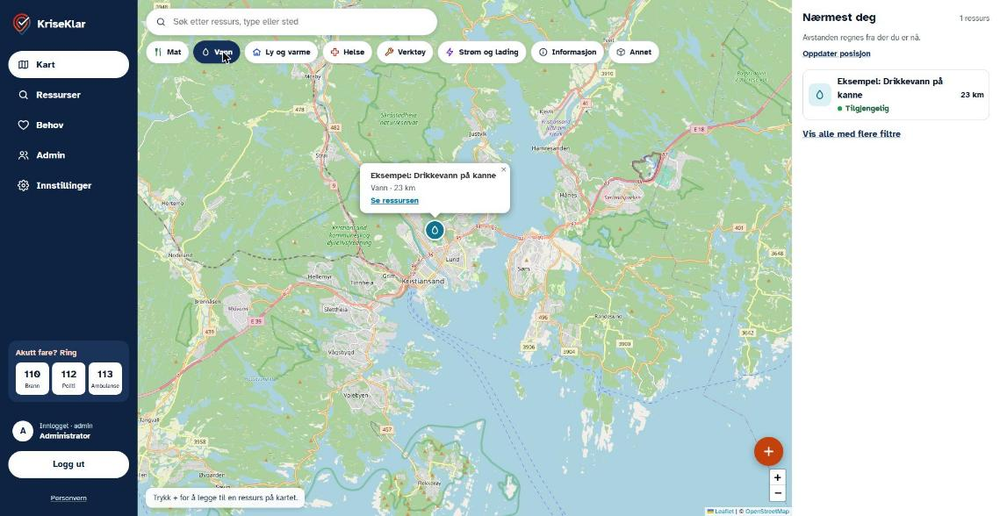

**Legg til en ressurs fra kartet:** Trykk den oransje **+**-knappen nede til høyre. Klikk så i kartet der ressursen er, og trykk **Registrer ressurs her**. Da åpnes skjemaet for ny ressurs med punktet ferdig valgt. **Avbryt** går ut av legg til-modus.

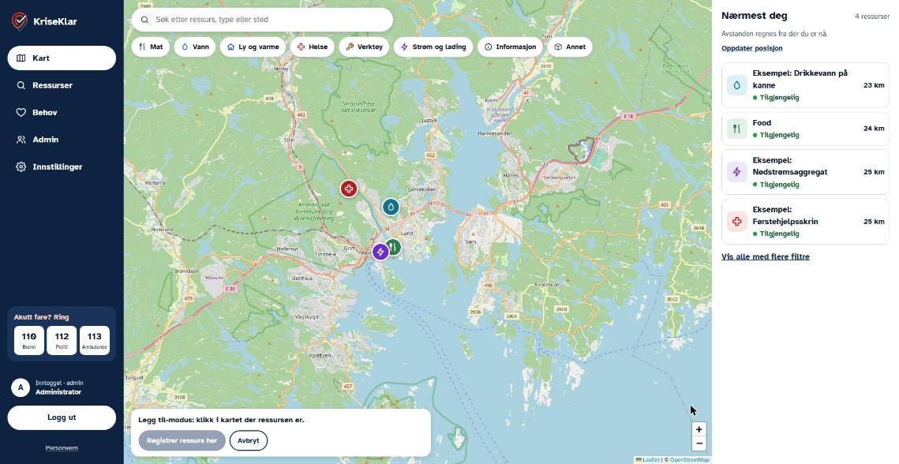

### 2. Ressurser

Under **Ressurser** ser du alle ressursene som kort. Hvert kort viser kategori, navn, sted, status, antall og avstand fra deg.

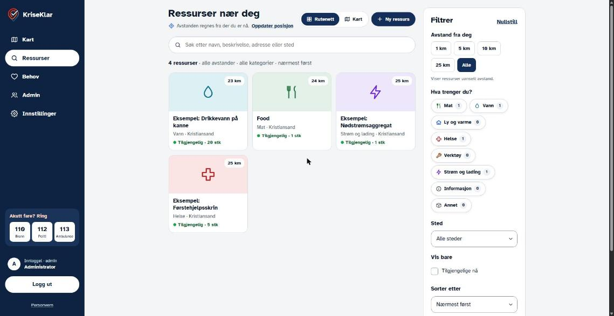

Til høyre er **Filtrer**:

- **Avstand fra deg:** 1 km, 5 km, 10 km, 25 km eller Alle.
- **Hva trenger du?** Velg én eller flere kategorier. Tallet viser hvor mange ressurser det finnes.
- **Sted:** Velg by/sted.
- **Vis bare:** Huk av for **Tilgjengelige nå**.
- **Sorter etter:** Nærmest først, Nyeste først eller Navn (A–Å).
- **Nullstill** fjerner alle filtrene.

Øverst kan du bytte mellom **Rutenett** (kort) og **Kart**:

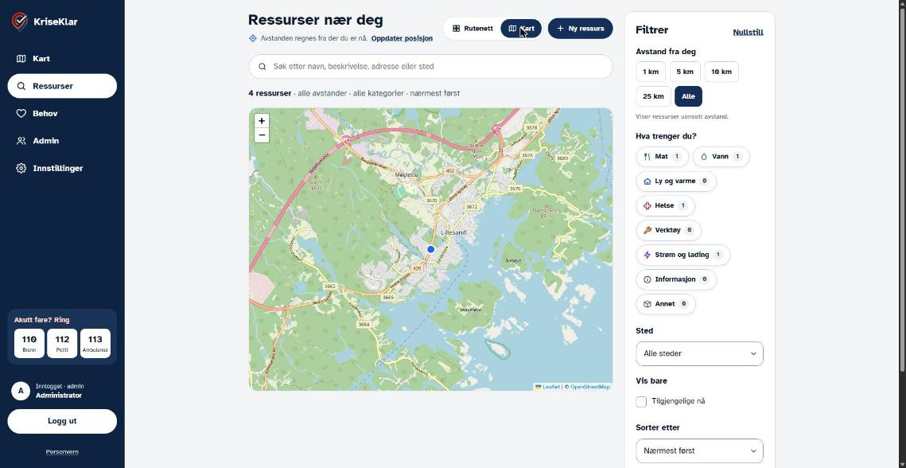

#### Se en ressurs

Klikk på et kort for å åpne ressursen. Her ser du kategori, status, antall, beskrivelse, plassering på kart, avstand, adresse og kontaktinfo. **Finn i kart** viser veien dit. Som admin ser du også knappene **Endre** og **Slett** på alle ressurser.

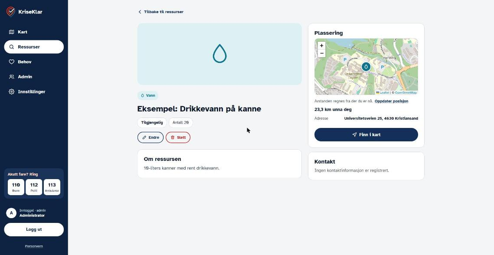

#### Meld inn en ny ressurs

Trykk **Ny ressurs** (eller **+** på kartet). Skjemaet har tre deler:

1. **Ressursen:** velg kategori, skriv navn og beskrivelse, sett antall og status (Tilgjengelig, I bruk, Utilgjengelig).
2. **Hvor er den?** (valgfritt): klikk i kartet eller trykk **Bruk min posisjon**, og fyll inn adresse, postnummer og poststed.
3. **Bilde og kontakt** (valgfritt): last opp et bilde (JPEG, PNG eller WebP, maks 5 MB) og skriv kontaktperson, telefon og e-post. Tomme felt betyr at telefonnummeret fra profilen din vises.

Trykk **Lagre ressurs**. **Avbryt** går tilbake uten å lagre.

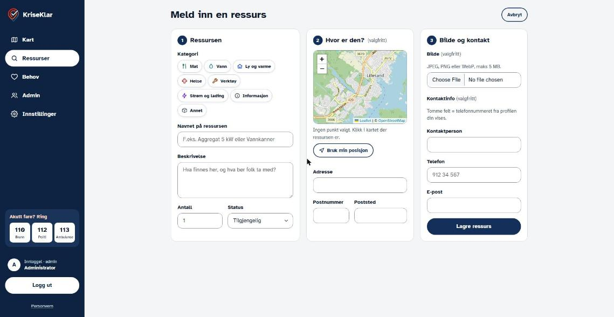

#### Endre en ressurs

Trykk **Endre** på ressursen. Du får det samme skjemaet med dagens verdier. Punktet på kartet kan dras til et nytt sted, eller fjernes med **Fjern punktet**. Trykk **Lagre endringer**.

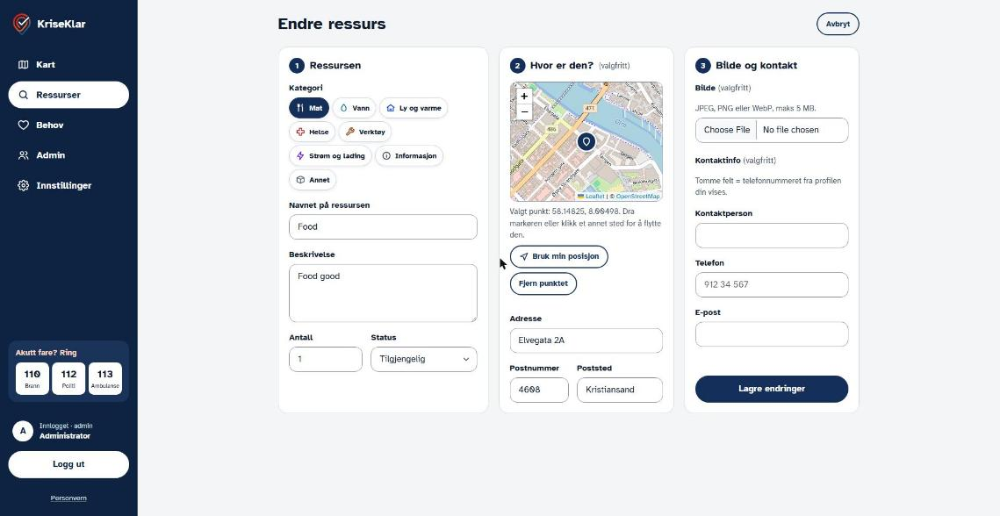

#### Slette en ressurs

Trykk **Slett**. Du får en side som spør om du er sikker. **Ja, slett ressursen** sletter den for alle brukere og fjerner den fra behov den er tildelt. Dette kan ikke angres. **Nei, behold den** går tilbake.

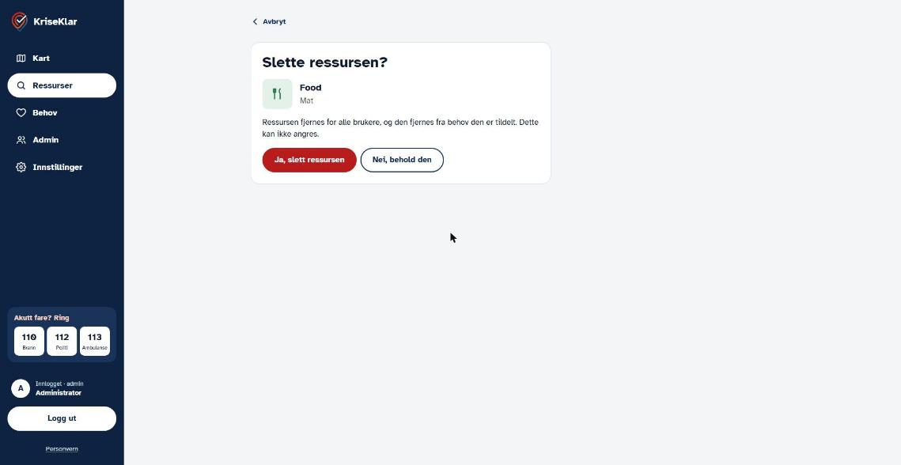

### 3. Behov

Under **Behov** ser du hva folk trenger nå. De mest kritiske står først, og behov som er dekket står sist.

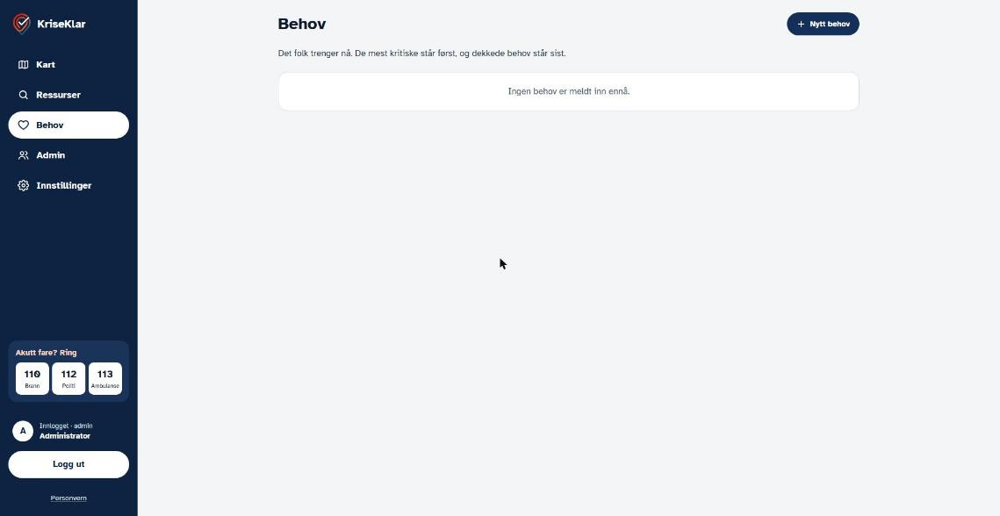

#### Meld inn et behov

Trykk **Nytt behov** og fyll ut:

- **Hva trengs?** – velg kategori.
- **Tittel** og **Beskrivelse** – hva trengs, til hvem og hvordan det skal leveres.
- **Antall som trengs** og **Prioritet** (Lav, Middels, Høy, Kritisk).
- **Frist**, **Organisasjon**, **Hvor trengs det?**, postnummer og poststed (alle valgfrie).

Trykk **Lagre behov**.

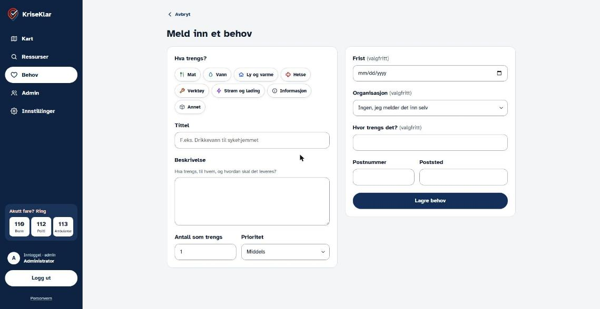

#### Se et behov og tildele ressurser

Klikk på et behov i listen for å åpne det. Der ser du detaljene (sted, hvem som meldte det inn, organisasjon, telefon) og **Tildelte ressurser**.

Under **Tildel en ressurs** velger du en ledig ressurs og antall, og trykker **Tildel**. En tildelt ressurs kan fjernes igjen fra tabellen. Når nok er tildelt, står det **Behovet er dekket**. Behovet kan også endres eller slettes med **Endre** og **Slett**.

Som admin kan du tildele alle ressurser og endre/slette alle behov.

### 4. Admin

Siden **Admin** finnes bare for administratorer. Øverst kan du hoppe til **Brukere**, **Ressurser** eller **Behov**.

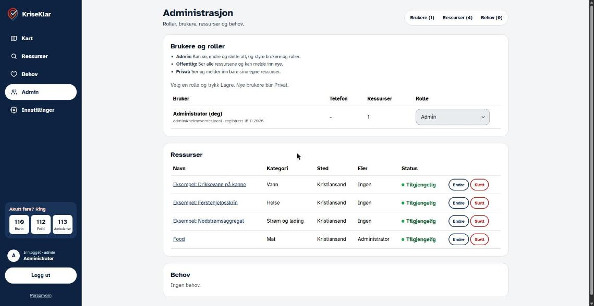

- **Brukere og roller:** Viser alle brukere med telefon og antall ressurser. Velg en rolle i nedtrekkslisten og trykk Lagre for å endre den. Rollene er:
  - **Admin:** kan se, endre og slette alt, og styre brukere og roller.
  - **Offentlig:** ser alle ressursene og kan melde inn nye.
  - **Privat:** ser og melder inn bare sine egne ressurser. Nye brukere blir Privat.
- **Ressurser:** Alle ressursene i én tabell med kategori, sted, eier og status. Knappene **Endre** og **Slett** fungerer som beskrevet over.
- **Behov:** Alle behov i én tabell.

### 5. Innstillinger

Under **Innstillinger** kan du:

- **Profil:** endre navn, e-post (brukes til innlogging) og telefon (vises som kontakt på ressursene dine). Trykk **Lagre profil**.
- **Bytt passord:** skriv nåværende passord og nytt passord to ganger. Passordet må ha minst 8 tegn, med stor og liten bokstav, tall og spesialtegn.
- **Om deg:** viser rollen din, når du ble registrert, og hvor mange ressurser og behov du har.
- **Dine data:** **Last ned mine data (JSON)** laster ned alt som er lagret om deg.
- **Slett kontoen:** en admin kan ikke slette sin egen konto. En annen admin må gjøre det.

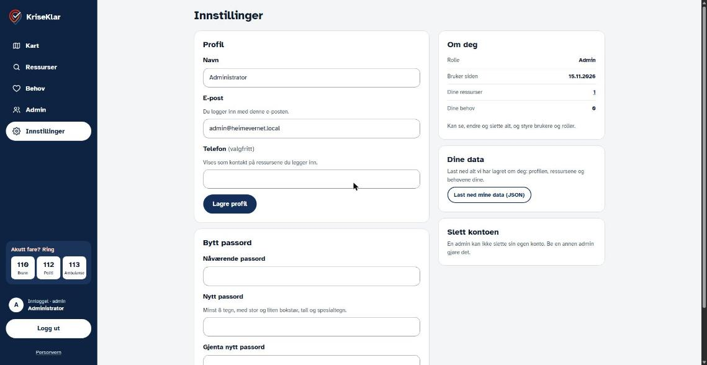

### 6. Personvern og utlogging

**Personvern** (nederst i menyen) forklarer hva appen lagrer: e-postadressen og en kryptert versjon av passordet, og en innloggingscookie.

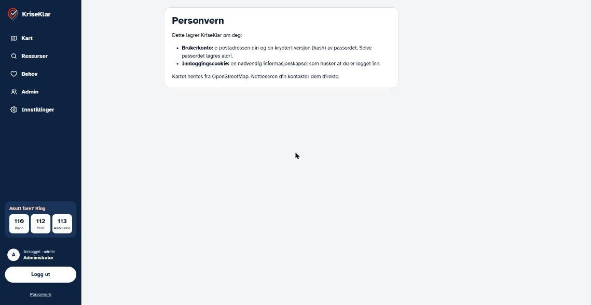

Trykk **Logg ut** nederst i menyen for å logge ut.

---

## Del 2: Vanlig bruker

En vanlig bruker får rollen **Privat** når kontoen lages. Det meste fungerer som for admin (se del 1), men noe er annerledes. Her er bare forskjellene.

| | Admin | Vanlig bruker (Privat) |
|---|---|---|
| Menyvalget **Admin** | Ja | Nei |
| Ser ressurser på kartet og i listen | Alle | Bare sine egne |
| Endre og slette ressurser | Alle | Bare sine egne |
| Endre og slette behov | Alle | Bare sine egne |
| Tildele ressurser til behov | Alle ressurser | Bare sine egne ressurser |
| Slette sin egen konto | Nei | Ja |

> Rollen **Offentlig** er en mellomting: den ser alle ressursene og kan melde inn nye, men har ikke Admin-siden. En admin kan gi deg den rollen.

### 1. Menyen

Menyen har ikke **Admin**. Nederst står det **Innlogget · privat** og navnet ditt.

### 2. Kartet: «Mine ressurser»

Listen til høyre heter **Mine ressurser** i stedet for **Nærmest deg**. Kartet og listen viser bare ressurser du selv har meldt inn. Har du ikke meldt inn noe, står det **Ingen ressurser er registrert ennå**. Du kan fortsatt legge til ressurser med **+**-knappen.

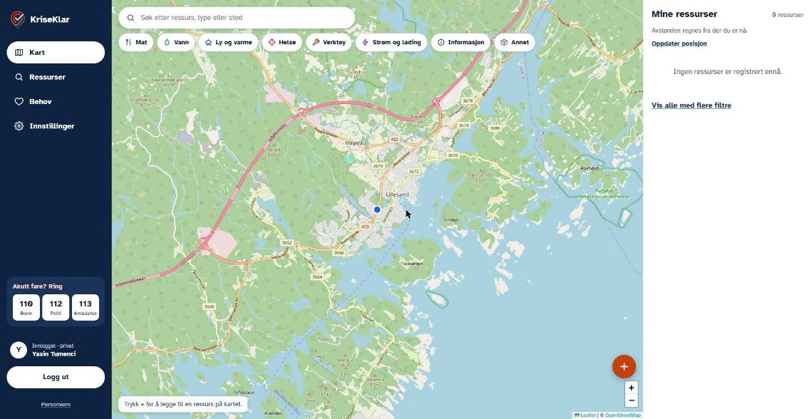

### 3. Ressurser: bare dine egne

Siden heter **Mine ressurser**. En blå boks forklarer at du er registrert som privatperson og bare ser ressursene du selv har meldt inn. Filtrene, søket og **Ny ressurs** fungerer som for admin, men filteret **Sted** vises bare når du har ressurser med sted. Ressurser som andre har meldt inn, kan du ikke åpne.

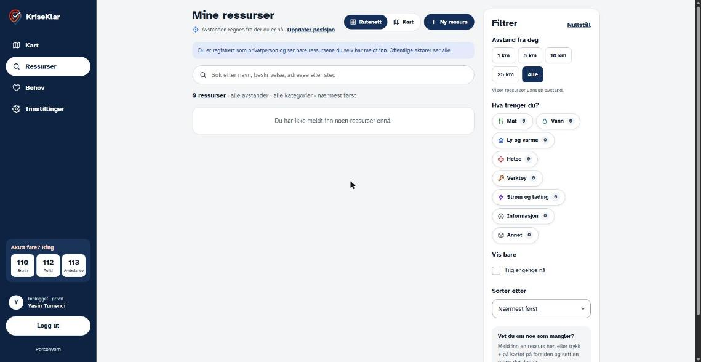

**Endre** og **Slett** finnes bare på ressurser du eier selv.

### 4. Behov

Siden **Behov** ser lik ut som for admin, og du kan melde inn nye behov på samme måte. Forskjellene er:

- Du kan bare **endre** og **slette** behov du har meldt inn selv.
- Når du **tildeler en ressurs** til et behov, kan du bare velge ressurser du eier. Har du ingen ledige, står det **Du har ingen ledige ressurser å tildele**, med en lenke til **Meld inn en ressurs**.
- En tildeling kan fjernes av den som eier behovet eller den som eier ressursen.

### 5. Innstillinger

Innstillingene er de samme som for admin, med to forskjeller:

- **Om deg** viser rollen **Privat**, og forklarer at en admin kan gi deg rollen Offentlig hvis du trenger å se alle ressursene.
- **Slett kontoen** har knappen **Slett kontoen min**. Kontoen og innloggingen slettes, men ressursene og behovene dine blir liggende uten eier, slik at andre fortsatt kan finne dem.

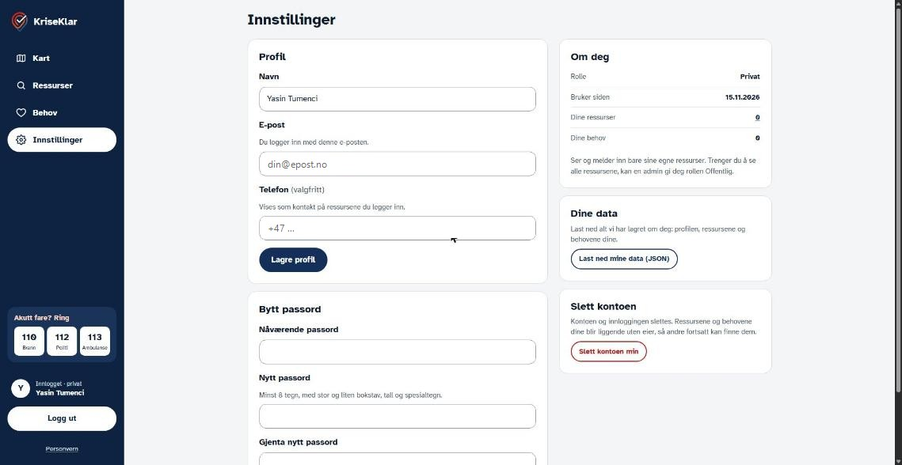

### 6. Ingen tilgang

Prøver du å åpne Admin-siden (for eksempel ved å skrive `/UserAdmin` i adressefeltet), får du siden **Ingen tilgang**. Trykk **Tilbake til kartet** for å gå tilbake.

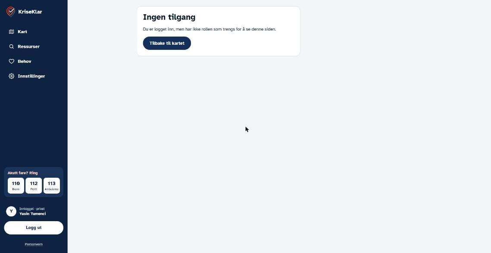
